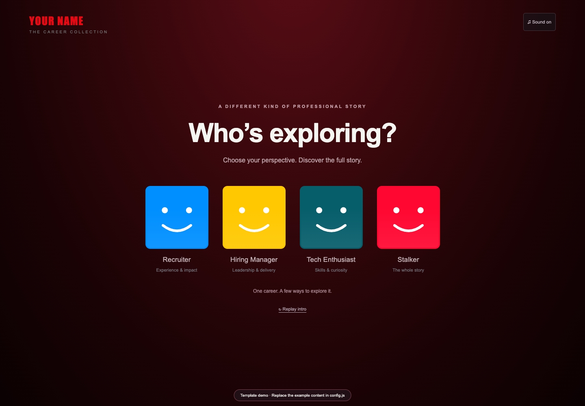

# Cinematic Portfolio Template

A streaming-inspired interactive portfolio built with HTML, CSS, and vanilla JavaScript. Click your name to start a cinematic intro with sound, choose a visitor profile, and browse your career like a collection of stories.

No backend, build step, framework, tracking, paid API, or runtime AI service required.



## Use this template

1. Click **Use this template → Create a new repository** on GitHub.
2. Edit **config.js** with your name, professional headline, profile choices, links, experience, expertise, achievements, credentials, education, and interests.
3. Replace every example record with your own accurate content. Set `demoMode: false` when finished.
4. Optionally add `assets/resume.pdf`, then set `resume: "assets/resume.pdf"`. No resume or personal documents are included. Resume links are hidden while this setting is empty.
5. Add your own email/social URLs. Empty links remain hidden. Optional record-level `logo` paths let you add logos you are allowed to use.
6. Customize the palette in **styles.css** and behavior in **app.js** if desired.

The example content is instructional placeholder text, not a real person's employment, credentials, education, or achievements.

## Preview locally

```sh
python3 -m http.server 4173 --bind 127.0.0.1
```

Open `http://127.0.0.1:4173/`. Click the name to start the intro, or use Skip intro. The explicit click lets browsers allow audible playback. The intro supports Enter/Space, Skip, mute, Escape, and automatic completion. Reduced-motion visitors receive a short static intro instead of the name zoom and automatic background motion.

## Deploy on GitHub Pages

1. Commit your changes to the repository's `main` branch.
2. Open **Settings → Pages**.
3. Select **Deploy from a branch**, **main**, **/ (root)**, then **Save**.
4. Wait for the Pages deployment in the Actions tab to finish.
5. Your site appears at `https://YOUR-USERNAME.github.io/YOUR-REPOSITORY/`.

Keep `.nojekyll`, `index.html`, `styles.css`, `config.js`, `app.js`, and `assets/` at the repository root. All bundled asset paths are relative and support a repository subpath.

## Features

- Four configurable visitor profiles, with profile-based collection ordering.
- Burgundy/black profile screen and bright profile tiles, responsive down to 320px.
- Name-click intro with original sound and local video.
- Three configurable hero slides, play/pause controls, and a video preview dialog.
- Horizontal collections, working carousel arrows, detail dialogs, Escape/outside dismissal, and focus return.
- Credential-category filters derived from your configuration.
- Optional resume PDF and contact links, availability badges, and a coming-soon feature.
- Keyboard access, native video controls, reduced-motion and data-saver considerations.
- No local personal information, resume, employment data, certificate records, or organization logos.

## Original media and licensing

Code is released under the **MIT License**. See [LICENSE](LICENSE).

The included original synthesized sound, AI artwork, and animation assembled from that artwork are also offered for reuse under the same MIT terms to the extent rights can be granted. AI-generated imagery may not attract copyright protection in every jurisdiction; no exclusive rights or third-party clearance are promised. See [MEDIA.md](MEDIA.md) for provenance.

This project is independent and is not affiliated with or endorsed by a streaming service. **No Netflix logo animation, Netflix sound recording, third-party organization logos, or personal resume is included.** The design is streaming-inspired; the provided media is original. If you substitute your own media, you are responsible for checking its reuse permissions.

## Tests

Install Playwright in your development environment and its Chromium browser:

```sh
npm install --no-save playwright
npx playwright install chromium
```

With the local server running:

```sh
node tests/verify.cjs
```

Optional environment variables: `BASE_URL` and `CHROMIUM_PATH`.

## Contributing

Bug fixes, accessibility improvements, and documentation updates are welcome. Please read [CONTRIBUTING.md](CONTRIBUTING.md). Avoid including real personal information, private documents, secrets, or unlicensed media in examples or pull requests.
